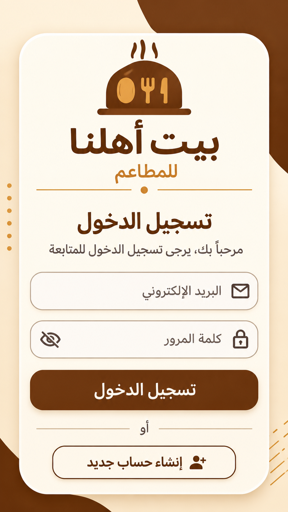
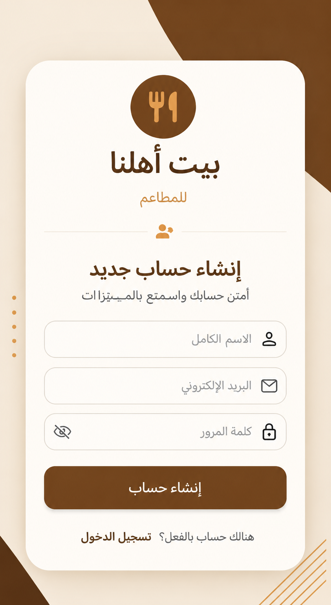
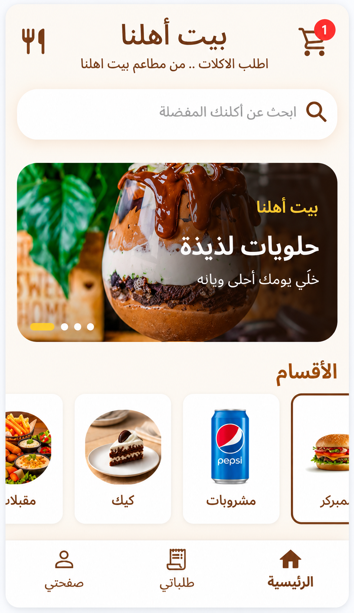
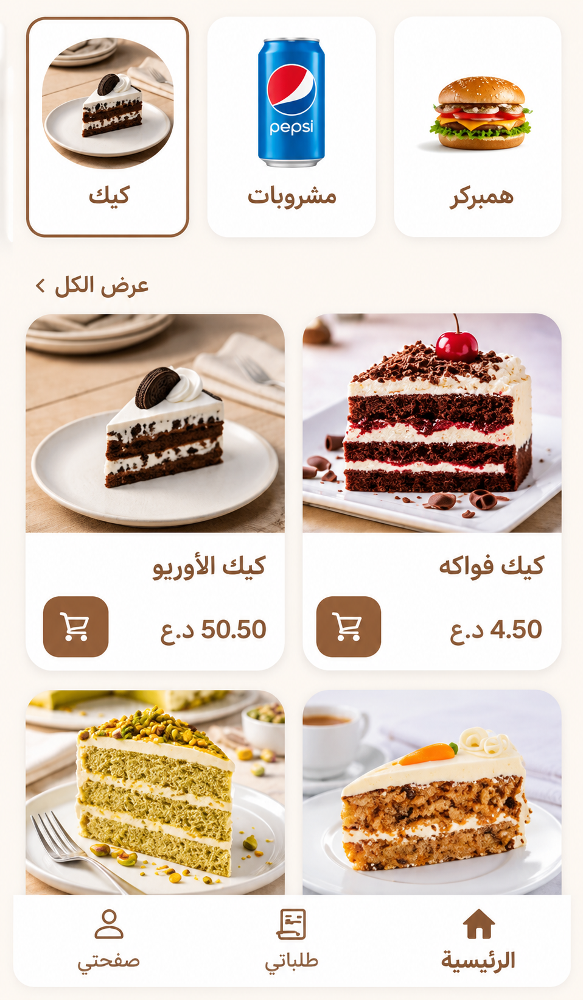
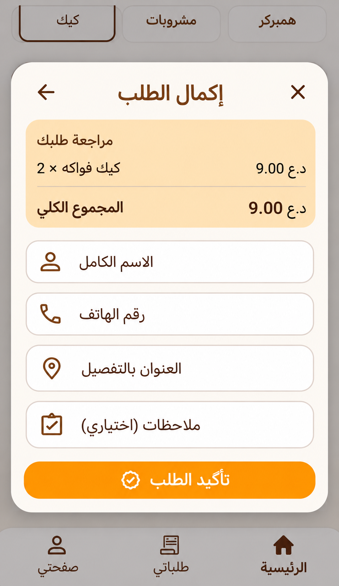
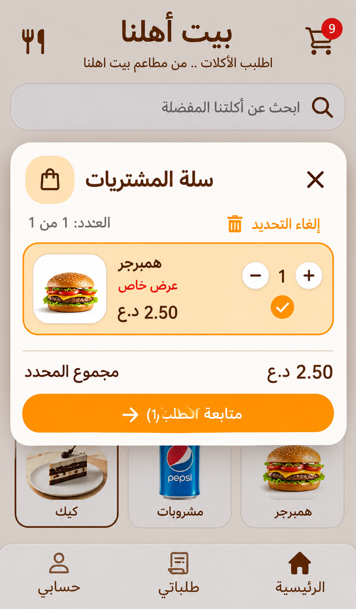
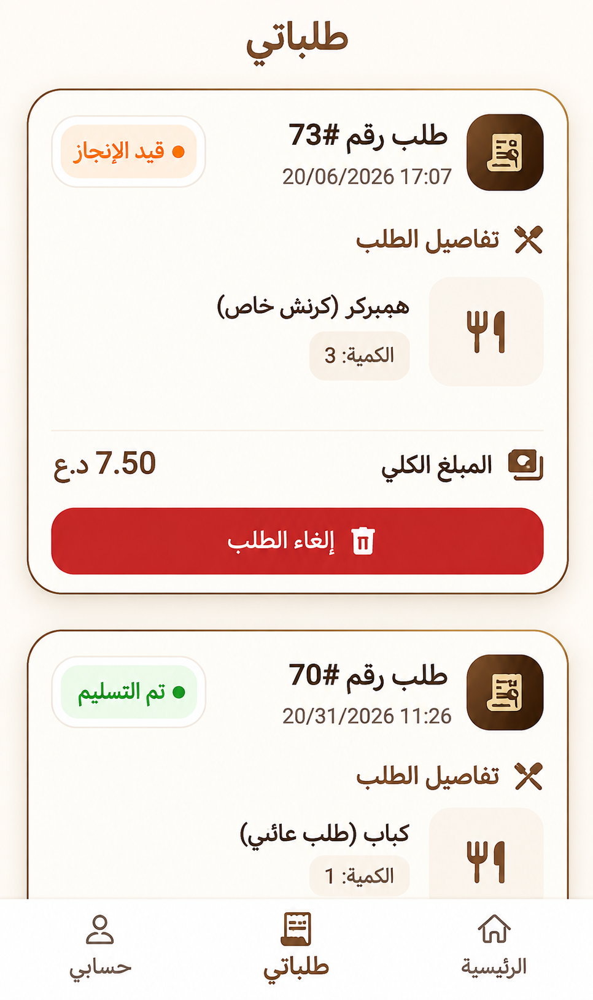
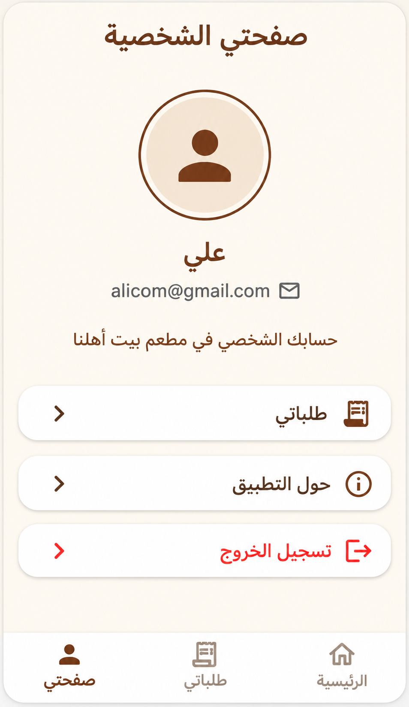

<!DOCTYPE html>
<html lang="ar" dir="rtl">
<head>
<meta charset="UTF-8">
<meta name="viewport" content="width=device-width, initial-scale=1.0">

<title>بيت أهلنا - واجهات التطبيق</title>

</head>

<body>

<header>
  <h1>🍽️ بيت أهلنا للمطاعم</h1>
  
واجهات تطبيق بيت أهلنا

</header>

<h2 class="section-title">
🔐 تسجيل الدخول وإنشاء الحساب
</h2>

<h3>تسجيل الدخول</h3>

<h3>إنشاء حساب جديد</h3>

<h2 class="section-title">
🏠 واجهات التطبيق الرئيسية
</h2>

<h3>الصفحة الرئيسية</h3>

<h3>صفحة المطاعم</h3>

<h3>تفاصيل الطعام</h3>

<h3>سلة المشتريات</h3>

<h3>صفحة الطلبات</h3>

<h3>الصفحة الشخصية</h3>

<footer>
جميع الحقوق محفوظة © بيت أهلنا للمطاعم
</footer>

</body>
</html>
